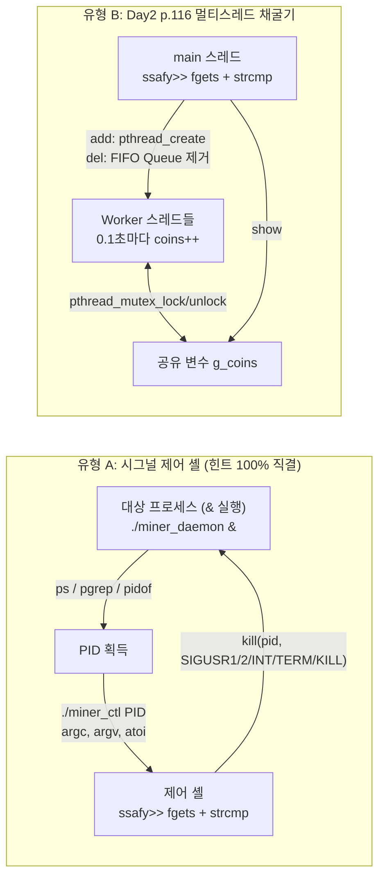

# 임베디드 리눅스 시스템 프로그래밍 실기 시험 대비 총정리

이 문서는 **Day2 p.116 `[도전 4] 채굴기 프로젝트`**, **Day3 시그널·프로세스·`Firmware / Person App`**, 그리고 **시험 핵심 힌트 7가지**를 결합해 실기 시험에서 막힘 없이 코드를 작성하고 검증할 수 있도록 정리한 가이드입니다.

---

## Part 0. 시험 출제 구조 분석

시험 힌트와 강의 자료를 대조해 보면, 이번 시험은 **두 프로세스 간 시그널 제어 셸(유형 A)** 또는 **단일 프로세스 내 스레드 채굴기 셸(유형 B)** 중 하나로 출제될 가능성이 매우 높습니다.

### 힌트 ↔ 강의 자료 매핑

| 시험 힌트 항목 | 핵심 API / 명령어 | 연결되는 강의 내용 |
|---|---|---|
| 채굴기 프로젝트 | `ssafy>> ` 프롬프트, `show` / `add` / `del` | Day2 p.116 `[도전 4] 채굴기 프로젝트` |
| 시그널 기초 | `SIGINT`, `SIGTERM`, `SIGKILL`, `SIGUSR1`, `SIGUSR2` | Day3 p.53~62 `Signal`, p.108 |
| 셸에서 프로세스 다루기 | `ps`, `pgrep`, `pidof`, `kill -시그널 PID`, `&` | Day3 p.7~8, p.39~44 |
| C에서 시그널 보내기 | `kill()`, `<signal.h>`, `<sys/types.h>`, `pid_t` | Day3 p.62 `kill() system call` |
| 명령 입력 반복 | 프롬프트 출력, `fgets`, 개행 제거, `strcmp`, 오류 안내 | Day3 p.107~108 Shell 구현 |
| 실행 인자 | `argc`, `argv`, `atoi`, 인자 개수 확인 | Day3 p.108 `$person 14212` |
| 빌드 | `gcc -o <출력파일> <소스.c>` | 전 실습 공통 (`-lpthread` 여부 구분) |

### 예상 출제 유형 2가지 비교

- **유형 A (가장 유력 — 힌트 7개 항목과 100% 일치)**:
  - 백그라운드(`&`)로 실행 중인 대상 프로세스(채굴기 데몬 또는 펌웨어)의 PID를 `ps`/`pgrep`/`pidof`로 확인한다.
  - 내가 작성한 제어 셸을 `./miner_ctl <PID>` 형태로 실행한다(`argc`, `argv`, `atoi`).
  - `ssafy>> ` 프롬프트에서 `fgets`로 명령어를 입력받고 개행을 제거한 뒤 `strcmp`로 구분하여 `kill(target_pid, SIG...)`를 보낸다.
  - 실습 파일: [`01_signal_shell/miner_daemon.c`](file:///home/hoyneed/linux_system_practice/01_signal_shell/miner_daemon.c), [`01_signal_shell/miner_ctl.c`](file:///home/hoyneed/linux_system_practice/01_signal_shell/miner_ctl.c)
- **유형 B (Day2 p.116 원형)**:
  - 단일 프로그램 안에서 `ssafy>> ` 프롬프트를 띄우고, 시작 시 채굴기 스레드 1개를 생성한다.
  - `show`(코인 출력), `add`(스레드 추가), `del`(FIFO 큐에서 가장 오래된 스레드 제거)을 `pthread`와 `mutex`로 구현한다.
  - 실습 파일: [`02_thread_miner/miner_thread.c`](file:///home/hoyneed/linux_system_practice/02_thread_miner/miner_thread.c)



---

## Part 1. 시그널 기초

시그널(Signal)은 리눅스에서 프로세스나 스레드에 **비동기 이벤트(Software Interrupt)**를 전달하는 신호입니다. `kill -l` 명령으로 전체 목록(1~64번)을 확인할 수 있습니다.

### 시험 필수 시그널 5종 (x86_64 Linux 기준)

| 번호 | 시그널 | 발생 계기 / 단축키 | 기본 동작 (Default) | 핸들러 등록 / 무시 | 시험·실무 핵심 용도 |
|---:|---|---|---|---|---|
| `2` | **`SIGINT`** | 터미널 `Ctrl + C` | **프로세스 종료 (Term)** | 가능 | 작업 중단 또는 상태 조회(`show`) 등 사용자 인터럽트 |
| `9` | **`SIGKILL`** | `kill -9 PID` | **즉시 강제 종료 (Term)** | **불가 (Catch/Ignore 불가)** | 응답 없는 프로세스를 커널이 즉시 정리 없이 종료 |
| `10` | **`SIGUSR1`** | 사용자 정의(`kill()`/`kill -USR1`) | **프로세스 종료 (Term)** | 가능 | 앱 정의 이벤트 1 (예: 채굴기 추가, 버튼 클릭) |
| `12` | **`SIGUSR2`** | 사용자 정의(`kill()`/`kill -USR2`) | **프로세스 종료 (Term)** | 가능 | 앱 정의 이벤트 2 (예: 채굴기 제거, 리셋) |
| `15` | **`SIGTERM`** | `kill PID` 기본 시그널 | **프로세스 종료 (Term)** | 가능 | 정상 종료 요청(자원 정리 후 안전 종료) |

### 함께 알아두면 좋은 참고 시그널

| 번호 | 시그널 | 발생 계기 | 기본 동작 | 비고 |
|---:|---|---|---|---|
| `14` | `SIGALRM` | `alarm(sec)` 타이머 만료 | 종료 (Term) | WDT(Watchdog Timer) 구현 핵심 |
| `17` | `SIGCHLD` | 자식 프로세스 종료/중지 | 무시 (Ign) | 부모가 `wait()`로 좀비 방지 |
| `18` | `SIGCONT` | `fg`, `bg`, `kill -CONT` | 정지 상태 재개 (Cont) | `T` 상태 프로세스를 다시 실행 |
| `19` | `SIGSTOP` | `kill -STOP PID` | **일시 정지 (Stop)** | **Catch/Ignore 불가** |
| `20` | `SIGTSTP` | 터미널 `Ctrl + Z` | 일시 정지 (Stop) | Catch/Ignore 가능 |

> [!IMPORTANT]
> **시험 단골 함정 2가지**
> 1. **`SIGUSR1`, `SIGUSR2`의 기본 동작은 "무시"가 아닙니다!** `signal()`로 핸들러를 등록하지 않은 프로세스에 `SIGUSR1`이나 `SIGUSR2`를 보내면 **프로세스가 즉시 종료**됩니다.
> 2. **`SIGKILL(9)`과 `SIGSTOP(19)`은 어떤 프로그램도 잡거나(`signal`) 무시(`SIG_IGN`)할 수 없습니다.** 반면 `SIGTERM(15)`은 핸들러를 등록해 정리 작업 후 종료할 수 있습니다.

---

## Part 2. 리눅스 셸에서 프로세스 다루기

### 1) 백그라운드 실행과 작업 제어
```bash
./miner_daemon &        # 프로세스를 백그라운드로 실행 (쉘 프롬프트 즉시 반환 + PID 출력)
jobs                    # 현재 쉘의 백그라운드/정지 작업 목록 확인 ([1]+ 실행중 ...)
fg %1                   # 1번 작업을 포어그라운드로 가져오기
# 포어그라운드 실행 중 Ctrl + Z -> SIGTSTP 전송, Stopped(T) 상태 진입
bg %1                   # 정지된 1번 작업을 백그라운드에서 재개 (SIGCONT)
```

### 2) PID 확인 명령어 3종 비교

| 명령어 | 특징 및 출력 | 실전 사용 예 | 주의사항 |
|---|---|---|---|
| **`ps`** | 프로세스 전체/상세 정보 출력 | `ps -ef \| grep miner_daemon` | `grep` 자기 자신도 검색 결과에 함께 뜸 (`grep -v grep` 또는 `grep '[m]iner_daemon'` 활용) |
| **`pgrep`** | 패턴과 일치하는 PID만 깔끔히 출력 | `pgrep -x miner_daemon`<br/>`pgrep -a miner` | `-x`는 정확한 이름 일치, `-a`는 PID+명령줄 함께 출력, `-f`는 전체 인자까지 검색 |
| **`pidof`** | 실행 파일 이름과 정확히 일치하는 PID 출력 | `pidof miner_daemon`<br/>`pidof -s miner_daemon` | 전체 명령줄이 아닌 **프로세스(바이너리) 이름**을 정확히 적어야 함 (`-s`는 첫 PID 1개만) |

### 3) 셸에서 시그널 보내기 (`kill`)
```bash
kill -l                     # 시그널 번호 및 이름 목록 확인
kill <PID>                  # 기본값은 SIGTERM(15) 전송
kill -SIGTERM <PID>         # 이름 전체로 전송
kill -USR1 <PID>            # SIG 접두사를 빼고 전송 가능
kill -10 <PID>              # 번호로 전송 (SIGUSR1)
kill -9 <PID>               # SIGKILL(9) 강제 종료
kill -0 <PID>               # 시그널은 보내지 않고 프로세스 존재/권한 여부만 검사 (종료코드 0=생존)
```

### 4) 실전 3단계 터미널 테스트 루틴
```bash
# 1단계: 대상 프로세스를 백그라운드로 실행
./01_signal_shell/miner_daemon &

# 2단계: PID 확인
pidof miner_daemon
# 또는: pgrep -a miner_daemon
# 또는: ps -ef | grep '[m]iner_daemon'

# 3단계: 시그널 전송 테스트
kill -SIGUSR1 <PID>   # 채굴기 추가 확인
kill -SIGINT <PID>    # 코인/채굴기 상태 출력 확인
kill -SIGUSR2 <PID>   # 채굴기 제거 확인
kill -SIGTERM <PID>   # 정상 종료 확인
```

---

## Part 3. C에서 시그널 보내기 (및 받기)

### 1) `kill()` 시스템 콜
```c
#include <sys/types.h>
#include <signal.h>

int kill(pid_t pid, int sig);
```
- **반환값**: 성공 시 `0`, 실패 시 `-1` (`errno` 설정 → `perror("kill")`로 원인 출력)
- **주요 `errno`**:
  - `ESRCH`: 해당 PID의 프로세스가 존재하지 않음 (이미 종료됨 또는 잘못된 PID)
  - `EPERM`: 해당 프로세스에 시그널을 보낼 권한이 없음
  - `EINVAL`: 유효하지 않은 시그널 번호(`sig`)

> [!CAUTION]
> **`pid` 값에 따른 `kill(pid, sig)` 동작 — 치명적 버그 주의!**
> - `pid > 0`: 지정한 PID를 가진 **특정 프로세스**에게 전송 (시험에서 의도하는 동작)
> - `pid == 0`: **호출한 프로세스와 같은 프로세스 그룹의 모든 프로세스**에게 전송! (`atoi("abc")`가 `0`을 반환하므로 검증 없이 `kill()`을 호출하면 자기 자신과 쉘 프로세스 그룹 전체가 죽을 수 있음!)
> - `pid == -1`: 권한이 있는 **시스템의 모든 프로세스**(init 제외)에게 전송
> - `pid < -1`: 프로세스 그룹 ID가 `-pid`인 그룹 전체에 전송
>
> **해결책**: `atoi` 직후 반드시 `if (target_pid <= 0)` 검사를 넣고, 가능하면 `if (kill(target_pid, 0) == -1)`로 대상 생존 여부를 사전 검증하세요.

### 2) `kill(pid, 0)`으로 생존 확인하기
`sig`에 `0`을 넘기면 실제 시그널을 전달하지 않고 커널이 **PID 존재 여부와 전송 권한만 검사**합니다.
```c
if (kill(target_pid, 0) == -1) {
    perror("Target process not reachable");
    return 1;
}
```

### 3) 시그널 수신 측 핵심 패턴 (참고)
```c
#include <signal.h>

static volatile sig_atomic_t g_flag = 0;

void handler(int sig) {
    if (sig == SIGUSR1) {
        g_flag = 1; /* 핸들러 안에서는 플래그만 바꾸는 것이 가장 안전 */
    }
}

int main(void) {
    signal(SIGUSR1, handler);
    ...
}
```
- 핸들러 시그니처는 반드시 `void func(int sig)`여야 합니다. (최신 GCC에서는 매개변수 없는 `void func()`로 선언하면 `signal()` 전달 시 컴파일 오류/경고가 발생합니다.)
- 시그널 핸들러 안에서 `printf()`나 `malloc()`을 직접 호출하는 것보다 `volatile sig_atomic_t` 플래그만 설정하고 `main` 루프에서 처리하는 방식이 안전합니다.

---

## Part 4. 명령 입력 반복 (대화형 셸 REPL 패턴)

```c
setbuf(stdout, NULL); /* 또는 매 printf("ssafy>> ") 뒤 fflush(stdout) */

char buf[256];
while (1) {
    printf("ssafy>> ");
    fflush(stdout);

    /* 1. EOF(Ctrl+D) 또는 읽기 오류 시 종료 */
    if (fgets(buf, sizeof(buf), stdin) == NULL) {
        printf("\n");
        break;
    }

    /* 2. 입력이 버퍼 크기를 초과한 경우 남은 문자열 비우기 */
    if (strchr(buf, '\n') == NULL && !feof(stdin)) {
        int ch;
        while ((ch = getchar()) != '\n' && ch != EOF) {
        }
    }

    /* 3. 개행 문자(\n, \r\n) 제거 */
    buf[strcspn(buf, "\r\n")] = '\0';

    /* 4. 빈 줄(Enter만 누른 경우)은 무시하고 다시 프롬프트 출력 */
    if (buf[0] == '\0') {
        continue;
    }

    /* 5. strcmp() == 0 으로 명령 구분 */
    if (strcmp(buf, "show") == 0) {
        ...
    } else if (strcmp(buf, "add") == 0) {
        ...
    } else if (strcmp(buf, "del") == 0) {
        ...
    } else if (strcmp(buf, "exit") == 0) {
        break;
    } else {
        printf("Unknown command: %s\n", buf);
    }
}
```

### 꼭 기억할 포인트
1. **프롬프트 출력 버퍼링**: `"ssafy>> "`에는 `\n`이 없기 때문에 표준 출력이 라인 버퍼링될 경우 화면에 프롬프트가 안 보일 수 있습니다. `fflush(stdout);` 또는 `setbuf(stdout, NULL);`를 반드시 넣으세요.
2. **개행 제거 2가지 방법**:
   - 방법 1 (권장): `buf[strcspn(buf, "\r\n")] = '\0';` (`\n`뿐 아니라 Windows 줄바꿈 `\r\n`도 안전하게 제거)
   - 방법 2: `size_t len = strlen(buf); if (len > 0 && buf[len - 1] == '\n') buf[len - 1] = '\0';`
3. **`strcmp` 반환값**: 두 문자열이 같으면 **`0`**을 반환합니다. `if (strcmp(buf, "add"))`라고 쓰면 정반대로 동작하므로 반드시 `== 0`을 명시하세요!
4. **공백/인자가 있는 명령 확장 시**: 만약 `kill 15`처럼 인자가 함께 들어올 가능성이 있다면 `char cmd[64]; int arg; sscanf(buf, "%63s %d", cmd, &arg)` 패턴으로 확장할 수 있습니다.

---

## Part 5. 실행 인자(`argc`, `argv`, `strtol`/`atoi`) & 빌드(`gcc -o`)

### 1) `argc` / `argv`와 `strtol()` 정석 처리
```c
#include <errno.h>
#include <limits.h>
#include <stdlib.h>

int main(int argc, char *argv[]) {
    if (argc != 2) {
        fprintf(stderr, "Usage: %s <PID>\n", argv[0]);
        return 1;
    }

    char *endptr = NULL;
    errno = 0;
    long val = strtol(argv[1], &endptr, 10);
    if (errno != 0 || endptr == argv[1] || *endptr != '\0' || val <= 0 || val > INT_MAX) {
        fprintf(stderr, "Invalid PID: %s\n", argv[1]);
        return 1;
    }
    pid_t pid = (pid_t)val;
    ...
}
```
- `argc`는 프로그램 이름(`argv[0]`)을 포함한 총 인자 개수입니다. 인자 1개(`<PID>`)를 받으려면 `argc == 2`여야 합니다.
- **왜 힌트의 `atoi()` 대신 `strtol()`이 권장되나요?**
  - `atoi("abc")` → `0` 반환 (`"0"`과 구분 불가, 검증 없이 `kill()`에 넘기면 프로세스 그룹 전체에 전송!)
  - `atoi("123abc")` → `123` 반환 (뒤에 붙은 문자를 무시하고 정상 숫자로 취급!)
  - 오버플로우 시 `atoi()`는 Undefined Behavior이지만 `strtol()`은 `errno = ERANGE`로 감지 가능
- `strtol()`의 4가지 체크 포인트: `errno != 0`(오버플로우), `endptr == argv[1]`(숫자 없음/빈 문자열), `*endptr != '\0'`(뒤에 문자 섞임), `val <= 0 || val > INT_MAX`(유효 PID 범위).

### 2) `gcc -o` 빌드 규칙
```bash
# 단일 C 파일 (시그널 제어 셸)
gcc -Wall -Wextra -o miner_ctl miner_ctl.c

# pthread 사용 시 (-lpthread 필수!)
gcc -Wall -Wextra -o miner_thread miner_thread.c -lpthread
```
> [!WARNING]
> **`gcc -o` 실수 주의!**
> `-o` 바로 뒤에 나오는 파일이 **덮어쓰기되는 출력 파일**입니다.
> `gcc -o miner_ctl.c`라고 잘못 입력하면 `miner_ctl.c` 소스 파일 자체가 바이너리로 덮어써지거나 링크 오류가 발생합니다. 반드시 **`gcc -o 실행파일 소스파일.c`** 순서를 지키세요.

---

## Part 6. 시험장 암기용 핵심 코드 템플릿

### 템플릿 A: 시그널 제어 셸 기본 골격 (유형 A 대비)
```c
#include <errno.h>
#include <limits.h>
#include <signal.h>
#include <stdio.h>
#include <stdlib.h>
#include <string.h>
#include <sys/types.h>

int main(int argc, char *argv[]) {
    if (argc != 2) {
        fprintf(stderr, "Usage: %s <PID>\n", argv[0]);
        return 1;
    }

    char *endptr = NULL;
    errno = 0;
    long val = strtol(argv[1], &endptr, 10);
    if (errno != 0 || endptr == argv[1] || *endptr != '\0' || val <= 0 || val > INT_MAX) {
        fprintf(stderr, "Invalid PID: %s\n", argv[1]);
        return 1;
    }
    pid_t pid = (pid_t)val;

    if (kill(pid, 0) == -1) {
        perror("Target PID check");
        return 1;
    }

    char buf[256];
    while (1) {
        printf("ssafy>> ");
        fflush(stdout);

        if (fgets(buf, sizeof(buf), stdin) == NULL) {
            printf("\n");
            break;
        }
        buf[strcspn(buf, "\r\n")] = '\0';
        if (buf[0] == '\0') continue;

        if (strcmp(buf, "show") == 0) {
            if (kill(pid, SIGINT) == -1) perror("kill(SIGINT)");
        } else if (strcmp(buf, "add") == 0) {
            if (kill(pid, SIGUSR1) == -1) perror("kill(SIGUSR1)");
        } else if (strcmp(buf, "del") == 0) {
            if (kill(pid, SIGUSR2) == -1) perror("kill(SIGUSR2)");
        } else if (strcmp(buf, "stop") == 0) {
            if (kill(pid, SIGTERM) == -1) perror("kill(SIGTERM)");
        } else if (strcmp(buf, "kill") == 0) {
            if (kill(pid, SIGKILL) == -1) perror("kill(SIGKILL)");
        } else if (strcmp(buf, "exit") == 0) {
            break;
        } else {
            printf("Unknown command: %s\n", buf);
        }
    }
    return 0;
}
```

### 템플릿 B: 스레드 + Mutex + FIFO Queue 골격 (유형 B / Day2 p.116 대비)
```c
#define _DEFAULT_SOURCE
#include <pthread.h>
#include <stdio.h>
#include <stdlib.h>
#include <string.h>
#include <unistd.h>

#define MAX_MINERS 64

typedef struct {
    pthread_t tid;
    volatile int running;
} Miner;

static long g_coins = 0;
static pthread_mutex_t g_mutex = PTHREAD_MUTEX_INITIALIZER;
static Miner *g_q[MAX_MINERS];
static int g_front = 0, g_rear = 0, g_cnt = 0;

void *worker(void *arg) {
    Miner *m = (Miner *)arg;
    while (m->running) {
        usleep(100000);
        if (!m->running) break;
        pthread_mutex_lock(&g_mutex);
        g_coins++;
        pthread_mutex_unlock(&g_mutex);
    }
    return NULL;
}

void add_miner(void) {
    if (g_cnt >= MAX_MINERS) return;
    Miner *m = malloc(sizeof(Miner));
    if (!m) return;
    m->running = 1;
    if (pthread_create(&m->tid, NULL, worker, m) != 0) {
        free(m);
        return;
    }
    g_q[g_rear] = m;
    g_rear = (g_rear + 1) % MAX_MINERS;
    g_cnt++;
}

void del_miner(void) {
    if (g_cnt == 0) {
        printf("No miners\n");
        return;
    }
    Miner *m = g_q[g_front];
    g_front = (g_front + 1) % MAX_MINERS;
    g_cnt--;
    m->running = 0;
    pthread_join(m->tid, NULL);
    free(m);
}
```

---

## Part 7. 실기 감점·버그 방지 체크리스트 TOP 10

1. **함수 시그니처 정확히 쓰기 (GCC 최신 버전 주의)**
   - 시그널 핸들러: `void handler(int sig)` (`void handler()` 금지)
   - 스레드 함수: `void *worker(void *arg)` (`void *worker()` 금지)
2. **`atoi` 반환값 `0`으로 인한 `kill(0, sig)` 사고 방지**
   - 반드시 `if (pid <= 0)` 검사 후 `kill()` 호출.
3. **`strcmp` 반환값 `0` 혼동 금지**
   - 같으면 `0`, 다르면 `0`이 아님 → 항상 `strcmp(buf, "cmd") == 0`.
4. **`fgets` 개행 문자 `\n` 제거 누락**
   - 제거하지 않으면 `"show\n"`과 `"show"`를 비교해 항상 불일치.
5. **프롬프트 `stdout` 버퍼링 미처리**
   - `printf("ssafy>> ");` 뒤에 `fflush(stdout);` 또는 시작 시 `setbuf(stdout, NULL);` 필수.
6. **`EOF` (`Ctrl+D`) 미처리로 인한 무한 루프**
   - `if (fgets(...) == NULL) break;` 없으면 파이프/EOF 입력 시 무한 반복.
7. **`SIGUSR1`/`SIGUSR2` 핸들러 미등록 주의**
   - 기본 동작이 프로세스 종료이므로, 수신 측 코드 작성 시 반드시 `signal()` 등록.
8. **`pthread_cancel`과 `pthread_mutex_lock` 동시 사용 시 데드락 위험**
   - `mutex`를 잡은 채 취소되면 다른 스레드 전체가 영구 대기 → `usleep()`은 반드시 락 밖에서 호출하고, 가능하면 종료 플래그(`running = 0`) + `pthread_join()` 패턴 사용.
9. **`kill()` 반환값 체크 누락**
   - 대상 프로세스가 이미 종료된 상태에서도 성공 로그를 찍지 않도록 `if (kill(...) == -1) perror("kill");` 확인.
10. **`gcc -o` 뒤에 소스 파일명 작성 실수**
    - `gcc -Wall -Wextra -o 실행파일 소스.c` 순서 유지, 백업 또는 `Makefile` 활용.
